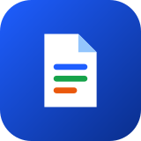

  
  <h1>AllVie v4.0</h1>
  
<strong>Universal Offline Android Document, PDF, Spreadsheet & PowerPoint Reader</strong>

  

    
    
    
  

---

## Overview

**AllVie v4.0** is a fast, zero-network document and office reader engineered for **Android 8.0 Oreo (API 26) through Android 16 (API 36)**.

### Key Features in v4.0
- **Android 8.0 – Android 16 ("Android 8-All") Compatibility**:
  - **Android 8.0–8.1 (API 26–27)**: Adaptive Launcher Icons (`mipmap-anydpi-v26`), Java 8 / D8 `--min-api 26` bytecode, v1 + v2 + v3 APK signing, Legacy External Storage + SAF picker, and native `Inflater` ZIP bridge.
  - **Android 9–10 (API 28–29)**: `requestLegacyExternalStorage="true"` transition support, display cutout adaptation, and system dark mode sync.
  - **Android 11–12L (API 30–32)**: Scoped Storage & `ACTION_SEND_MULTIPLE` multi-file batch share and delete.
  - **Android 13–16 (API 33–36)**: Monochrome themed adaptive icon (`ic_launcher_monochrome`), zero-permission Storage Access Framework (`ACTION_OPEN_DOCUMENT`), and system `ACTION_VIEW` document opener.
- **High-Fidelity PPTX Presentation Engine**:
  - Interactive **List**, **Slide**, and fullscreen **Play** modes with auto-play timer, laser pointer, zoom/pan controls, thumbnail filmstrip, and progress scrubber.
  - Full support for Master/Layout inheritance, theme color transforms (`lumMod`, `lumOff`, `tint`, `shade`), tables, charts, vector shapes, and connectors.
- **Multi-File Batch Selection**:
  - Select multiple files across **Files**, **Recents**, and **Bookmarks** for one-tap **Share** and **Delete**.
- **Unified Stacked-Card File Badges**:
  - Distinct card-style badges for `PDF`, `DOC`, `XLS`, `PPT`, `TXT`, `CSV`, and `XML`.
